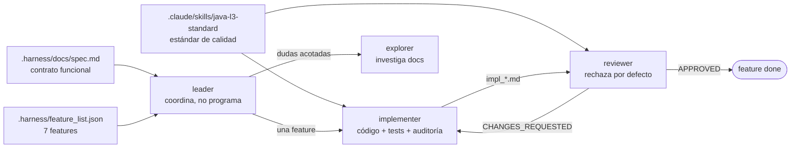

# api-bank-harness

Arnés de agentes (Claude Code) para construir desde cero una **Transaction Execution API** en Java 21 + Spring Boot 4, a partir de una especificación funcional y un estándar de calidad escrito.

El repo empieza sin código. Los agentes construyen la solución feature por feature. Ninguna se cierra sin evidencia ejecutable.

## Cómo funciona



| Pieza | Función |
|---|---|
| `.claude/CLAUDE.md` | Rol `leader`, stack fijo y prohibiciones |
| `.claude/agents/` | `leader`, `implementer`, `reviewer`, `explorer` |
| `.claude/skills/java-l3-standard/` | Checklist de calidad (arquitectura, dominio, persistencia, proveedor, API, tests) |
| `.claude/settings.json` | Hooks: compilar al editar, unitarios al parar |
| `.harness/docs/spec.md` | Contrato funcional con reglas RN01–RN07 y requerimientos RT01–RT05 |
| `.harness/feature_list.json` | Features en orden de dependencia, con criterios de aceptación |
| `.harness/CHECKPOINTS.md` | Criterios objetivos de estado final |
| `.harness/init.sh` | Verificación del entorno + `./mvnw verify` |
| `.harness/git-hooks/pre-commit` | Bloquea commits con reportes sin archivar |
| `.harness/progress/` | Estado de la sesión, bitácora y reportes archivados |

## Requisitos

- Java 21+
- Docker (Testcontainers y Docker Compose)
- Python 3 (scripts del arnés)
- [Claude Code](https://claude.com/claude-code)

## Uso

```bash
./.harness/init.sh   # configura git hooks y verifica el entorno
claude               # el agente arranca como leader
```

Prompt inicial sugerido:

```
Arranca la siguiente feature pendiente de .harness/feature_list.json.
```

## Garantías del proceso

- **Una feature a la vez**, en orden. `init.sh` falla si hay más de una `in_progress`.
- **El reviewer rechaza por defecto**: aprueba solo con evidencia propia (tests leídos, `./mvnw verify`, `curl` contra el compose), nunca por lo que reporta el implementer.
- **Cada regla de la spec tiene una fila** en la matriz del implementer y en la del reviewer, con `archivo:línea`.
- **La arquitectura es ejecutable**: un test de ArchUnit verifica dependencias entre paquetes y el uso de `@Transactional`.
- **Sin solución de referencia**: los agentes no leen implementaciones existentes del reto; trabajan desde la spec y el estándar.
