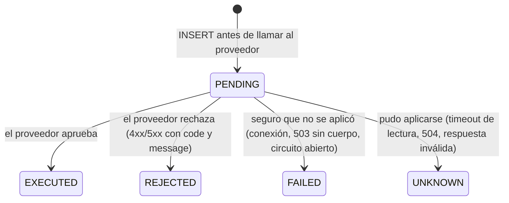
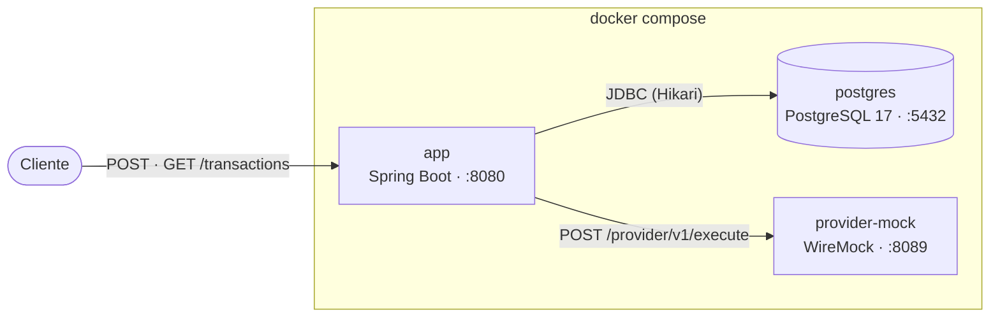
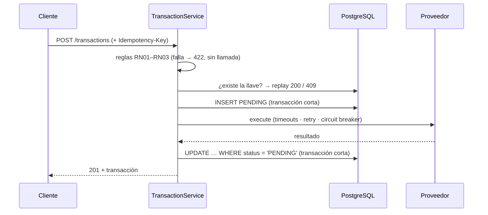
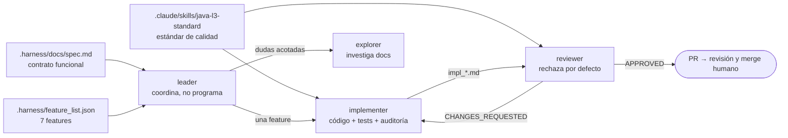

# Transaction Execution API

API REST que ejecuta transacciones `CREDIT` y `DEBIT` contra un proveedor externo, persiste el resultado y expone una consulta paginada.

- **Stack:** Java 21, Spring Boot 4 (Spring MVC + virtual threads), PostgreSQL 17 + Flyway, `RestClient` + Resilience4j, springdoc-openapi.
- **Tests:** JUnit 5, AssertJ, Mockito, WireMock, Testcontainers y ArchUnit.
- **Contrato funcional:** [`.harness/docs/spec.md`](.harness/docs/spec.md).
- **Decisiones:** [`docs/adr/`](docs/adr/).

## Contenido

1. [Cómo levantarlo](#cómo-levantarlo)
2. [Escenarios con `curl`](#escenarios-con-curl)
3. [API](#api)
4. [Estados de una transacción](#estados-de-una-transacción)
5. [Arquitectura](#arquitectura)
6. [Persistencia: por qué PostgreSQL](#persistencia-por-qué-postgresql)
7. [Escalabilidad](#escalabilidad)
8. [Limitaciones y mejoras](#limitaciones-y-mejoras)
9. [Tests](#tests)
10. [Decisiones de arquitectura (ADR)](#decisiones-de-arquitectura-adr)
11. [Uso de IA](#uso-de-ia)

## Cómo levantarlo

Requisitos: Docker. Para compilar o correr los tests fuera de Docker: Java 21.

```bash
docker compose up --build -d
curl -s localhost:8080/actuator/health        # {"groups":["liveness","readiness"],"status":"UP"}
```

| Servicio | Puerto | Qué es |
|---|---|---|
| `app` | `8080` | La API. Imagen multi-stage del `Dockerfile` (JRE 21, capas de Spring Boot, usuario no root `spring`) |
| `postgres` | `5432` | PostgreSQL 17 (db, usuario y contraseña: `transactions`) |
| `provider-mock` | `8089` | WireMock con los stubs de [`wiremock/mappings/`](wiremock/mappings/) |

- OpenAPI: <http://localhost:8080/v3/api-docs>. Swagger UI: <http://localhost:8080/swagger-ui.html>.
- Peticiones recibidas por el proveedor simulado: `curl -s localhost:8089/__admin/requests`.
- Apagar: `docker compose down -v`. El compose no declara un volumen con nombre para Postgres, así que los datos no sobreviven a `docker compose down` (con o sin `-v`): cada `up` arranca con la BD vacía. `-v` solo evita que queden volúmenes anónimos huérfanos.

Para correr la app desde el IDE o con Maven, contra el Postgres y el WireMock del compose:

```bash
docker compose up -d postgres provider-mock
./mvnw spring-boot:run
```

### Configuración

Todo valor de entorno es `${VAR:default}` en [`application.yaml`](src/main/resources/application.yaml):

| Variable | Default | Uso |
|---|---|---|
| `DB_URL`, `DB_USER`, `DB_PASSWORD` | `jdbc:postgresql://localhost:5432/transactions`, `transactions`, `transactions` | Conexión a Postgres |
| `DB_POOL_SIZE` | `20` | Conexiones de Hikari: el límite real de concurrencia hacia la BD |
| `PROVIDER_BASE_URL` | `http://localhost:8089` | URL del proveedor (`http://provider-mock:8080` dentro del compose) |
| `PROVIDER_CONNECT_TIMEOUT` / `PROVIDER_READ_TIMEOUT` | `1s` / `3s` | Timeouts del cliente. Si se excede el de lectura, el resultado es `UNKNOWN` |
| `PROVIDER_RETRY_*`, `PROVIDER_CB_*` | ver `application.yaml` | Reintentos y circuit breaker |

## Escenarios con `curl`

El proveedor simulado decide el resultado según el `accountId` del body:

| `accountId` | Qué responde el proveedor | Estado de la transacción | `code` persistido |
|---|---|---|---|
| cualquier otro (p. ej. `acc-123456`) | 200 `APPROVED` con `transactionId`, `balance: 5500.00`, `executedAt` | `EXECUTED` | — |
| `acc-insufficient-funds` | 422 `{"status":"REJECTED","code":"INSUFFICIENT_FUNDS","message":"The account does not have enough balance to complete the transaction"}` | `REJECTED` | `INSUFFICIENT_FUNDS` |
| `acc-provider-down` | 503 sin cuerpo | `FAILED` | `PROVIDER_ERROR` |
| `acc-slow` | 200 después de 5 s (el `read-timeout` es 3 s) | `UNKNOWN` | `PROVIDER_TIMEOUT` |

Las salidas siguientes son reales, tomadas de `docker compose up --build` (encabezados omitidos). Los `id` y las fechas cambian en cada ejecución.

**1. Aprobada → 201 `EXECUTED`**

```bash
curl -s -i -X POST localhost:8080/transactions -H 'Content-Type: application/json' \
  -d '{"accountId":"acc-123456","type":"CREDIT","amount":1500.00,"currency":"MXN","description":"Transferencia recibida"}'
```
```json
HTTP/1.1 201
{"id":"01a18480-fb4e-7034-9aa5-d02fcc7bfc34","accountId":"acc-123456","type":"CREDIT","amount":1500.00,"currency":"MXN","description":"Transferencia recibida","status":"EXECUTED","providerTransactionId":"txn-ne8ewckjzhzm","balanceAfter":5500.00,"createdAt":"2026-10-28T21:53:27.877488Z"}
```

**2. Rechazo por fondos insuficientes → 201 `REJECTED`**. La transacción se creó; el estado indica el resultado.

```bash
curl -s -i -X POST localhost:8080/transactions -H 'Content-Type: application/json' \
  -d '{"accountId":"acc-insufficient-funds","type":"DEBIT","amount":2500.00,"currency":"MXN","description":"Pago con saldo insuficiente"}'
```
```json
HTTP/1.1 201
{"id":"01a18480-fbd5-7104-9efc-688768b2436b","accountId":"acc-insufficient-funds","type":"DEBIT","amount":2500.00,"currency":"MXN","description":"Pago con saldo insuficiente","status":"REJECTED","providerTransactionId":null,"balanceAfter":null,"createdAt":"2026-10-28T21:53:28.020838Z"}
```

**3. Proveedor caído (503 sin cuerpo) → 201 `FAILED`**

```bash
curl -s -i -X POST localhost:8080/transactions -H 'Content-Type: application/json' \
  -d '{"accountId":"acc-provider-down","type":"DEBIT","amount":100.00,"currency":"MXN"}'
```
```json
HTTP/1.1 201
{"id":"01a18480-fbed-792a-b95c-83e829885799","accountId":"acc-provider-down","type":"DEBIT","amount":100.00,"currency":"MXN","description":null,"status":"FAILED","providerTransactionId":null,"balanceAfter":null,"createdAt":"2026-10-28T21:53:28.045405Z"}
```

**4. Proveedor lento → 201 `UNKNOWN`** después de unos 3 s, sin reintentos (la operación pudo aplicarse).

```bash
curl -s -i -X POST localhost:8080/transactions -H 'Content-Type: application/json' \
  -d '{"accountId":"acc-slow","type":"CREDIT","amount":300.00,"currency":"MXN"}'
```
```json
HTTP/1.1 201
{"id":"01a18480-fbfc-70e6-a828-5bee2844c19a","accountId":"acc-slow","type":"CREDIT","amount":300.00,"currency":"MXN","description":null,"status":"UNKNOWN","providerTransactionId":null,"balanceAfter":null,"createdAt":"2026-10-28T21:53:28.059868Z"}
```

Para ver lo que se persistió de cada una (incluidos `code` y `message`, RN06):

```bash
docker compose exec postgres psql -U transactions -d transactions \
  -c "select account_id, status, code, message, provider_transaction_id from transactions order by created_at"
```
```
       account_id       |  status  |        code        |                               message
------------------------+----------+--------------------+----------------------------------------------------------------------
 acc-123456             | EXECUTED |                    |
 acc-insufficient-funds | REJECTED | INSUFFICIENT_FUNDS | The account does not have enough balance to complete the transaction
 acc-provider-down      | FAILED   | PROVIDER_ERROR     | El proveedor respondió HTTP 503 sin cuerpo
 acc-slow               | UNKNOWN  | PROVIDER_TIMEOUT   | El proveedor no respondió a tiempo; resultado incierto
```

**5. Regla de negocio violada → 422.** El proveedor no recibe la llamada (RN04).

```bash
# RN01: el monto debe ser mayor a 1.00 (1.00 exacto se rechaza)
curl -s -i -X POST localhost:8080/transactions -H 'Content-Type: application/json' \
  -d '{"accountId":"acc-123456","type":"CREDIT","amount":1.00,"currency":"MXN"}'
# 422 {"detail":"El monto debe ser mayor a 1.00","instance":"/transactions","status":422,"title":"Unprocessable Content","code":"AMOUNT_TOO_LOW"}

# RN02: un DEBIT no puede pasar de 10,000.00 (10000.00 exacto se acepta)
curl -s -i -X POST localhost:8080/transactions -H 'Content-Type: application/json' \
  -d '{"accountId":"acc-123456","type":"DEBIT","amount":10000.01,"currency":"MXN"}'
# 422 {..."code":"DEBIT_AMOUNT_EXCEEDS_LIMIT"}

# RN03: solo MXN
curl -s -i -X POST localhost:8080/transactions -H 'Content-Type: application/json' \
  -d '{"accountId":"acc-123456","type":"CREDIT","amount":1500.00,"currency":"USD"}'
# 422 {..."code":"UNSUPPORTED_CURRENCY"}

# Formato: más de 2 decimales
curl -s -i -X POST localhost:8080/transactions -H 'Content-Type: application/json' \
  -d '{"accountId":"acc-123456","type":"CREDIT","amount":1500.005,"currency":"MXN"}'
# 400 {..."code":"VALIDATION_ERROR","errors":[{"field":"amount","message":"admite como máximo 17 enteros y 2 decimales"}]}
```

**6. Idempotencia: la primera vez → 201; el replay → 200 con la misma transacción, sin volver a llamar al proveedor.**

```bash
curl -s -i -X POST localhost:8080/transactions -H 'Content-Type: application/json' -H 'Idempotency-Key: pedido-42' \
  -d '{"accountId":"acc-777","type":"DEBIT","amount":10000.00,"currency":"MXN","description":"Pago de nómina"}'
# 201 {"id":"01a18481-0865-715e-a15c-3b376b4a6677",...,"status":"EXECUTED","providerTransactionId":"txn-ca12ytk7vmv9",...}

# El mismo comando otra vez:
# 200 {"id":"01a18481-0865-715e-a15c-3b376b4a6677",...}   ← mismo id
```

**7. Misma llave con otro payload → 409**

```bash
curl -s -i -X POST localhost:8080/transactions -H 'Content-Type: application/json' -H 'Idempotency-Key: pedido-42' \
  -d '{"accountId":"acc-777","type":"DEBIT","amount":9000.00,"currency":"MXN","description":"Pago de nómina"}'
# 409 {"detail":"La Idempotency-Key ya se usó con un payload distinto","instance":"/transactions","status":409,"title":"Conflict","code":"IDEMPOTENCY_KEY_CONFLICT"}
```

**8. Consulta con filtros y paginación (RN07)**

```bash
curl -s 'localhost:8080/transactions?accountId=acc-777&status=EXECUTED&type=DEBIT'
# 200 {"content":[{"id":"01a18481-0865-715e-a15c-3b376b4a6677","accountId":"acc-777",...}],"page":0,"limit":20,"totalElements":1,"totalPages":1}

curl -s 'localhost:8080/transactions?status=UNKNOWN'
# 200 {"content":[{...,"accountId":"acc-slow",...,"status":"UNKNOWN",...}],"page":0,"limit":20,"totalElements":1,"totalPages":1}

curl -s 'localhost:8080/transactions?page=1&limit=2'
# 200 {"content":[<acc-provider-down>,<acc-insufficient-funds>],"page":1,"limit":2,"totalElements":5,"totalPages":3}

curl -s 'localhost:8080/transactions?limit=101'
# 400 {..."code":"VALIDATION_ERROR","errors":[{"field":"limit","message":"debe ser menor o igual a 100"}]}
```

Al final, `curl -s localhost:8089/__admin/requests` muestra **5** llamadas al proveedor: las 4 transacciones de los escenarios 1 a 4 y la primera del escenario 6. Los 422, el 400, el replay y el 409 no llegaron al proveedor.

> El circuit breaker cuenta los `FAILED` y los `UNKNOWN`: con 10 llamadas o más en la ventana y al menos 50 % de fallas, se abre durante 30 s. Si repites muchas veces los escenarios 3 y 4, las siguientes transacciones quedan `FAILED` con `PROVIDER_CIRCUIT_OPEN`, sin que se haga la llamada al proveedor. Así se comporta el circuito, no es un error.

## API

### `POST /transactions`

Request (campos de la spec):

| Campo | Tipo | Validación de formato (400) | Regla de negocio (422) |
|---|---|---|---|
| `accountId` | string | obligatorio, máx. 100 | — |
| `type` | `CREDIT` \| `DEBIT` | obligatorio; otro valor → `MALFORMED_REQUEST` | — |
| `amount` | número | obligatorio, máx. 17 enteros y 2 decimales | RN01 `> 1.00`; RN02 DEBIT `≤ 10,000.00` |
| `currency` | string | obligatorio | RN03 solo `MXN` |
| `description` | string | opcional, máx. 255 | — |

Header opcional `Idempotency-Key` (máx. 100). Ver [ADR-0007](docs/adr/0007-idempotencia-por-idempotency-key.md).

Flujo, en el orden de la spec: validar formato → reglas RN01–RN03 → `INSERT PENDING` → proveedor → `UPDATE` con el resultado → responder.

| HTTP | Cuándo | Body |
|---|---|---|
| **201** | Se creó la transacción, **también si el proveedor la rechazó o falló** (el `status` lo indica) | `TransactionResponse` |
| **200** | Replay de una `Idempotency-Key` ya registrada con el mismo payload; puede seguir `PENDING` si la original aún espera al proveedor | `TransactionResponse` |
| 400 | Formato inválido (`VALIDATION_ERROR`, `MALFORMED_REQUEST`) | `ProblemDetail` + `errors` |
| 409 | Llave usada con otro payload (`IDEMPOTENCY_KEY_CONFLICT`) | `ProblemDetail` |
| 422 | Regla violada (`AMOUNT_TOO_LOW`, `DEBIT_AMOUNT_EXCEEDS_LIMIT`, `UNSUPPORTED_CURRENCY`) | `ProblemDetail` |
| 500 | Error inesperado (`INTERNAL_ERROR`), sin detalles internos | `ProblemDetail` |

`TransactionResponse` tiene exactamente los 10 campos del ejemplo de la spec: `id`, `accountId`, `type`, `amount`, `currency`, `description`, `status`, `providerTransactionId`, `balanceAfter` y `createdAt`.

### `GET /transactions`

| Query param | Default | Validación |
|---|---|---|
| `accountId` | — | filtro exacto; en blanco = sin filtro |
| `status` | — | `PENDING`, `EXECUTED`, `REJECTED`, `FAILED`, `UNKNOWN`; otro valor → 400 |
| `type` | — | `CREDIT`, `DEBIT`; otro valor → 400 |
| `page` | `0` | base 0, `≥ 0` |
| `limit` | `20` | `1..100` |

Los filtros se combinan con AND. El orden es estable, `createdAt desc, id desc`: ninguna fila se repite ni se pierde entre páginas. Respuesta: `{"content":[...],"page":0,"limit":20,"totalElements":N,"totalPages":M}`.

### Errores

Todos los errores son [RFC 9457](https://www.rfc-editor.org/rfc/rfc9457) (`application/problem+json`) y llevan la propiedad `code`, estable y en inglés. Ver [ADR-0008](docs/adr/0008-contrato-de-errores-rfc-9457.md).

### Proveedor externo

`POST {PROVIDER_BASE_URL}/provider/v1/execute` con `{accountId, type, amount, currency}`. Cómo se clasifica cada respuesta:

| Respuesta del proveedor | Estado | ¿Reintento? |
|---|---|---|
| 2xx `APPROVED` con `transactionId`, `balance` y `executedAt` | `EXECUTED` | — |
| 4xx o 5xx con cuerpo `{status, code, message}` | `REJECTED` con ese `code` y `message` | No |
| 500/502/503 sin cuerpo, 4xx sin cuerpo | `FAILED` | No |
| Conexión rechazada, timeout de conexión | `FAILED` (`PROVIDER_UNAVAILABLE`) después de 3 intentos | Sí, con backoff exponencial y jitter |
| Circuito abierto | `FAILED` (`PROVIDER_CIRCUIT_OPEN`), sin llamar | — |
| Timeout de lectura, 504 sin cuerpo, conexión cortada, respuesta inválida | `UNKNOWN` | **Nunca**: la operación pudo aplicarse |

Ver [ADR-0006](docs/adr/0006-resiliencia-del-cliente-del-proveedor.md).

## Estados de una transacción



| Estado | Significado | ¿Se movió dinero? |
|---|---|---|
| `PENDING` | Registrada; la llamada al proveedor está en curso (o el proceso murió a la mitad) | No se sabe todavía |
| `EXECUTED` | Aprobada. Tiene `providerTransactionId` y `balanceAfter` (RN05) | Sí |
| `REJECTED` | El proveedor la rechazó. Se persisten su `code` y su `message` (RN06) | No |
| `FAILED` | La petición no llegó o el proveedor respondió con un error sin cuerpo | No |
| `UNKNOWN` | Resultado incierto: un timeout no prueba que la operación no se aplicó | **Tal vez**: hay que conciliar |

Cada transacción cambia de estado una sola vez. Lo garantizan la entidad y un `UPDATE … WHERE status = 'PENDING'`. Ver [ADR-0005](docs/adr/0005-estados-y-resultado-incierto.md).

## Arquitectura



Paquetes por funcionalidad, con capas controller → service → repository dentro de cada uno, e inversión de dependencias **solo hacia el proveedor**:

```
mx.gilortiz.transactions
├── transaction/        controller, servicio, reglas RN01–RN03, entidad, repositorio, puerto TransactionProvider
│   └── dto/            records HTTP (CreateTransactionRequest, TransactionResponse)
├── provider/http/      adaptador HttpTransactionProvider (RestClient + Resilience4j)
└── common/web/         errores RFC 9457 y respuesta paginada
```

- El dominio define el puerto `TransactionProvider`, que devuelve un tipo sellado (`Approved`, `Rejected`, `Failed`, `Unknown`) y nunca lanza excepciones. El servicio lo procesa con un `switch` exhaustivo.
- `provider/http` depende de `transaction` y nunca al revés. ArchUnit lo verifica, junto con dos reglas más: ningún `@Transactional` en clases que lleguen al proveedor y nada de `@Autowired` en campos.
- No hay arquitectura hexagonal completa: la entidad JPA es el modelo, y servicio, reglas y repositorio son clases concretas, sin interfaces de una sola implementación. Ver [ADR-0002](docs/adr/0002-paquete-por-funcionalidad-y-puerto-del-proveedor.md).

Flujo de `POST`, **sin conexión de BD retenida durante la llamada al proveedor**:



## Persistencia: por qué PostgreSQL

Requisito RT01. Detalle en [ADR-0004](docs/adr/0004-postgresql-y-modelo-de-datos.md).

- **Es un registro de dinero.** Necesita transacciones ACID, durabilidad y `NUMERIC(19,2)` exacto (`BigDecimal` en Java, nunca `double`).
- **La correctitud vive en la BD, no en la memoria de una réplica.** Hay tres piezas:
  - `UNIQUE (idempotency_key)` arbitra las carreras entre réplicas.
  - `UPDATE … WHERE status = 'PENDING'` hace que el cambio de estado ocurra una sola vez.
  - `CHECK` sobre `type` y `status` impide valores inválidos.
- **La consulta es relacional.** RN07 filtra por `accountId`, `status` y `type`, combinados con AND y paginados. Cada filtro tiene un índice compuesto que termina en `(created_at, id)`, el mismo orden de la paginación, así que el orden sale del índice.
- **Un modelo simple.** Es una sola tabla, `transactions`, con esquema versionado en Flyway; Hibernate solo valida (`ddl-auto: validate`). Los ids son UUID v7 generados en la app: ordenables por tiempo y sin ida y vuelta a la BD.
- **Se prueba contra lo mismo que corre.** Los tests de integración usan Postgres 17 con Testcontainers; no se usa H2.

Se descartaron:
- **MongoDB/DynamoDB:** la unicidad y la transición condicional necesitan mecanismos propios, y el modelo es tabular y de esquema fijo.
- **H2:** no persiste y no se comporta como Postgres.

## Escalabilidad

La spec habla de millones de transacciones diarias: 10 millones al día son unas 115 TPS en promedio, con picos de varias veces eso.

- **La app no guarda estado.** La idempotencia y la transición de estado las resuelve la BD, así que se escala horizontalmente con más réplicas detrás de un balanceador.
- **Virtual threads.** Cada request espera al proveedor (hasta 3 s) sin ocupar un hilo de plataforma. El límite real hacia la BD es `DB_POOL_SIZE` ([ADR-0003](docs/adr/0003-spring-mvc-con-virtual-threads.md)).
- **No se retiene ninguna conexión durante la llamada al proveedor.** El INSERT y el UPDATE corren en transacciones cortas. Un test lo demuestra: con un pool de 2 conexiones, 10 requests esperan al proveedor a la vez con 0 conexiones activas.
- **Protección frente al proveedor.** Los timeouts acotan la espera y el circuit breaker corta rápido cuando el proveedor está caído, en lugar de acumular requests de 3 s.
- **Índices para cada filtro y `limit ≤ 100`** protegen la BD en el GET.
- **Siguientes pasos si hiciera falta**, sin cambiar el diseño:
  - Réplicas de lectura de Postgres para el GET.
  - Particionar `transactions` por `created_at`.
  - PgBouncer delante de Postgres.
  - Paginación keyset.

## Limitaciones y mejoras

| Tema | Situación actual | Mejora posible |
|---|---|---|
| **Conciliación** | `UNKNOWN` y los `PENDING` que no avanzan (el proceso murió o falló el UPDATE final) quedan registrados, y el resultado del proveedor queda en el log `ERROR`, pero **nadie los concilia**: está fuera del alcance del reto | Job que consulte al proveedor por `providerTransactionId` o por cuenta, monto y fecha, y cierre el estado |
| **Motivo del rechazo** | El response de la spec no incluye `code`/`message`, así que el cliente ve `REJECTED` sin saber por qué. Se persisten en la BD (RN06) | Exponerlos, con un ADR, si el consumidor lo necesita |
| **`count(*)` por página** | Cada `GET` hace la consulta de la página y un conteo para `totalElements`/`totalPages`; con tablas grandes y filtros poco selectivos el conteo es caro | Paginación keyset (`WHERE (created_at, id) < (?, ?)`) con cursor, sin conteo total |
| **Páginas profundas** | El offset recorre las filas que salta | Keyset (misma mejora) |
| **`FAILED` consume la llave** | El replay de una llave cuyo intento terminó en `FAILED` devuelve ese `FAILED`; para reintentar hay que usar una llave nueva. Es intencional: `FAILED` y `UNKNOWN` no se distinguen con seguridad sin conciliar | — |
| **Duplicado en vuelo** | Si la petición original aún espera al proveedor, la repetición con la misma llave recibe 200 con `status: PENDING`. No bloquea ni vuelve a llamar al proveedor | Endpoint `GET /transactions/{id}` para consultar el estado (la spec no lo define) |
| **Llaves sin expiración** | `Idempotency-Key` no tiene TTL | Expirarlas o purgarlas por antigüedad |
| **Circuito por instancia** | Cada réplica tiene su propio circuit breaker | Aceptable; compartir estado agregaría infraestructura |
| **Seguridad** | Sin autenticación ni autorización (la spec no las pide) | OAuth2 / mTLS hacia el proveedor |
| **Observabilidad** | Solo `/actuator/health` e `info` | Métricas de Micrometer (Resilience4j y Hikari) y trazas |

## Tests

```bash
./mvnw test       # unitarios (*Test): reglas, entidad, servicio con mock del puerto, adaptador contra WireMock, controller, ArchUnit
./mvnw verify     # + integración (*IT) contra Postgres de Testcontainers y WireMock; requiere Docker. Cobertura en target/site/jacoco/
```

- **Reglas:** valores frontera explícitos (`1.00`, `1.01`, `10000.00`, `10000.01`, `USD`).
- **Adaptador:** probado contra WireMock real: aprobado, rechazo, 5xx sin cuerpo, 504, timeout, conexión rechazada con reintentos y circuito abierto.
- **`TransactionFlowIT`:** HTTP real → reglas → WireMock → Postgres. Cubre la carrera de 10 requests con la misma llave (una fila, una llamada al proveedor) y la ausencia de conexiones retenidas durante la llamada.
- **CI:** [`.github/workflows/ci.yml`](.github/workflows/ci.yml) corre `./mvnw verify` y SonarCloud en cada PR ([ADR-0001](docs/adr/0001-cobertura-jacoco-e-integracion-continua.md)).

## Decisiones de arquitectura (ADR)

| ADR | Decisión |
|---|---|
| [0001](docs/adr/0001-cobertura-jacoco-e-integracion-continua.md) | Cobertura con JaCoCo y CI con GitHub Actions |
| [0002](docs/adr/0002-paquete-por-funcionalidad-y-puerto-del-proveedor.md) | Paquete por funcionalidad, capas e inversión de dependencias solo hacia el proveedor |
| [0003](docs/adr/0003-spring-mvc-con-virtual-threads.md) | Spring MVC bloqueante sobre virtual threads |
| [0004](docs/adr/0004-postgresql-y-modelo-de-datos.md) | PostgreSQL y modelo de datos |
| [0005](docs/adr/0005-estados-y-resultado-incierto.md) | Estados, `PENDING` previo y resultado incierto (`UNKNOWN`) |
| [0006](docs/adr/0006-resiliencia-del-cliente-del-proveedor.md) | Timeouts, reintento solo de conexión y circuit breaker |
| [0007](docs/adr/0007-idempotencia-por-idempotency-key.md) | Idempotencia con `Idempotency-Key` y `UNIQUE` |
| [0008](docs/adr/0008-contrato-de-errores-rfc-9457.md) | Contrato de errores RFC 9457 con `code` estable |

## Uso de IA

Requisito RT04. El código, los tests y esta documentación se escribieron con [Claude Code](https://claude.com/claude-code) dentro de un **arnés de agentes**. Su propósito es que la IA construya feature por feature con reglas verificables, y que ninguna feature se cierre por lo que el agente dice de sí mismo.

### Cómo se trabajó



- **Spec primero.** El PDF del reto se transcribió a [`.harness/docs/spec.md`](.harness/docs/spec.md), con las reglas RN01–RN07 desglosadas en sub-cláusulas verificables. Por ejemplo, "1.00 se rechaza" y "1.01 se acepta" son dos checks distintos. Campos, paths y estados se copian literal.
- **Siete features en orden de dependencia** ([`.harness/feature_list.json`](.harness/feature_list.json)), cada una con criterios de aceptación: bootstrap, reglas, cliente del proveedor, servicio de ejecución, endpoints, integración y entrega.
- **Roles separados** ([`.claude/agents/`](.claude/agents/)):
  - **leader:** descompone y coordina. No edita código.
  - **implementer:** hace una sola feature. Entrega código y tests, una matriz regla → implementación → test (`archivo:línea`) y una tabla de auditoría contra el estándar.
  - **reviewer:** rechaza por defecto. Solo aprueba con evidencia propia: lee los tests, corre `./mvnw verify` y hace `curl` contra el compose.
  - **explorer:** investiga dudas acotadas de documentación.
- **Estándar de calidad escrito** ([`.claude/skills/java-l3-standard/SKILL.md`](.claude/skills/java-l3-standard/SKILL.md)). Es un checklist de arquitectura, dominio, persistencia, proveedor, API, tests y estilo: por ejemplo, "nunca reintentar un timeout de lectura" o "ninguna conexión retenida durante la llamada HTTP". El implementer lo audita y el reviewer verifica cada fila.
- **La arquitectura es ejecutable.** ArchUnit convierte las reglas del estándar en tests, así que no dependen de la memoria del revisor.
- **`/code-review` adicional en las features críticas:**
  - **Resiliencia (3):** llevó a clasificar el 504 como `UNKNOWN` y a agregar backoff con jitter.
  - **Idempotencia y transacciones (4):** llevó al UPDATE dirigido, a la escala del monto y a no perder el resultado si falla el UPDATE.
  - **Concurrencia (6):** llevó a un oráculo de orden independiente en los tests.
- **CI y Sonar.** Cada PR corre `./mvnw verify` y el análisis de SonarCloud. Los issues de código que reportó Sonar se corrigieron en el código, sin desactivar reglas.
- **Trazabilidad.** Cada feature deja sus reportes de implementación y revisión en [`.harness/progress/archive/`](.harness/progress/archive/) y una entrada en [`history.md`](.harness/progress/history.md). Los ADRs documentan las decisiones tal como quedaron en esos reportes.
- **Persona en el circuito.** Una feature es una rama y un PR. Los agentes no hacen commit, push ni merge sin pedido explícito; el autor revisó y mergeó cada PR.
- **Configuración base de un proyecto previo del autor.** Las versiones, las dependencias, el `application.yaml` y el compose de partida se extrajeron de un proyecto previo del autor, **solo configuración y sin código**. Están en [`.harness/docs/reference-config.md`](.harness/docs/reference-config.md).
- **Sin solución de referencia para el código.** Los agentes no leyeron implementaciones existentes del reto, ni siquiera la de ese proyecto previo: el código y los tests se escribieron desde la spec y el estándar, a partir de esa configuración base.

### Piezas del arnés

| Pieza | Función |
|---|---|
| [`.claude/CLAUDE.md`](.claude/CLAUDE.md) | Rol `leader`, stack fijo y lo que no se debe introducir |
| [`.claude/settings.json`](.claude/settings.json) | Hooks: compilar al editar y correr los unitarios al parar |
| [`.harness/AGENTS.md`](.harness/AGENTS.md) | Mapa de navegación para los agentes |
| [`.harness/CHECKPOINTS.md`](.harness/CHECKPOINTS.md) | Criterios objetivos del estado final |
| [`.harness/init.sh`](.harness/init.sh) | Verifica el entorno y corre `./mvnw verify`; es requisito para cerrar una feature |
| [`.harness/git-hooks/pre-commit`](.harness/git-hooks/pre-commit) | Bloquea commits con reportes sin archivar |

Para reproducir el flujo:

```bash
./.harness/init.sh   # configura los git hooks y verifica el entorno
claude               # el agente arranca como leader
```

### Qué hizo la IA y qué hizo la persona

- **IA:** escribió el código, los tests, la configuración (partiendo de la base de `reference-config.md`), el Dockerfile, los stubs, los ADRs y este README. También hizo la revisión cruzada entre agentes y el triage del `/code-review`.
- **Persona:** definió el arnés, el estándar y el stack; aportó la configuración base de un proyecto previo suyo (solo configuración, sin código; ver `.harness/docs/reference-config.md`), y revisó y mergeó cada PR. Las decisiones que la spec no cubre (no exponer `code`/`message`, que `FAILED` consuma la llave, el 200 `PENDING` del duplicado en vuelo) quedaron documentadas en los reportes y en los ADRs para esa revisión.
