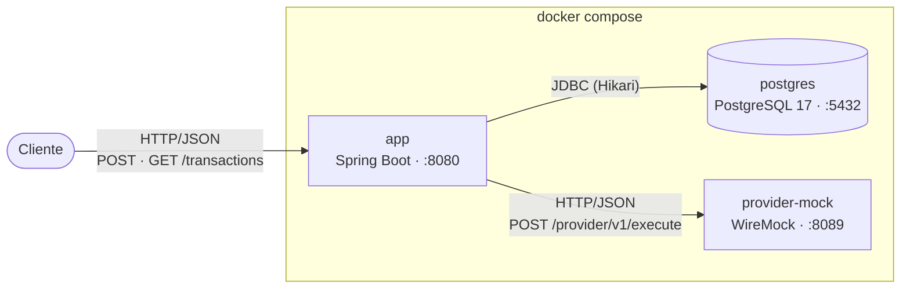
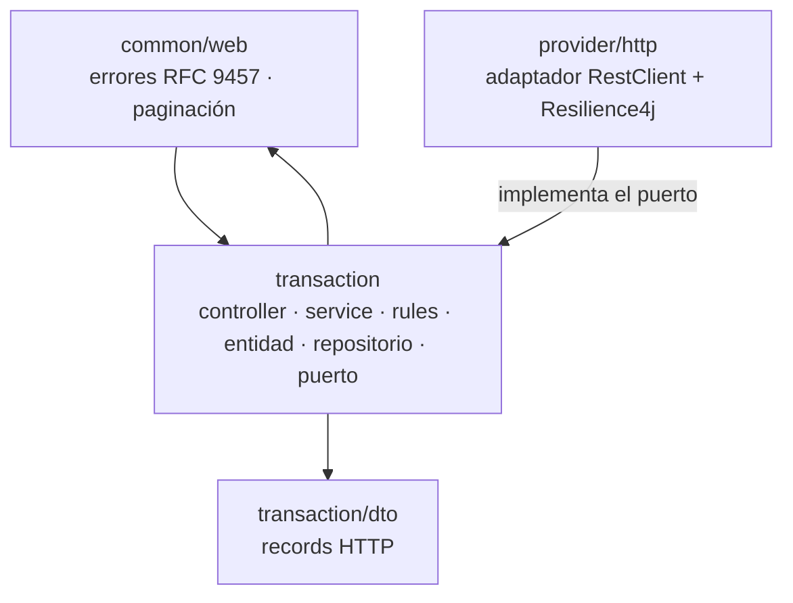
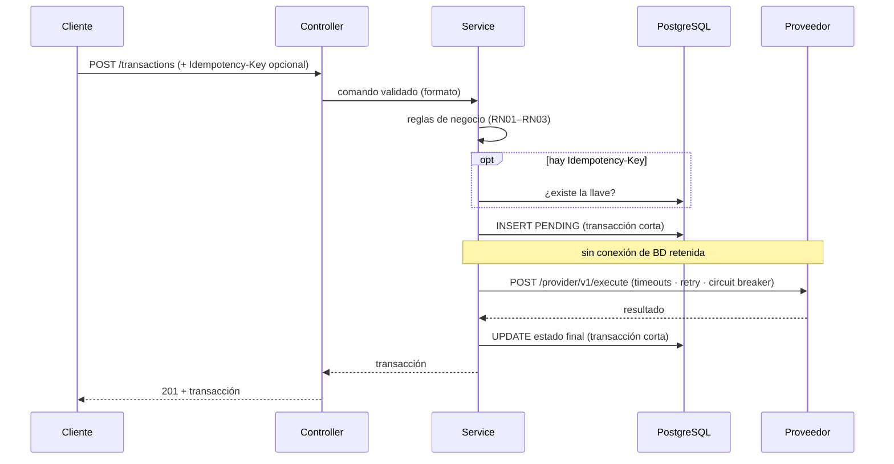
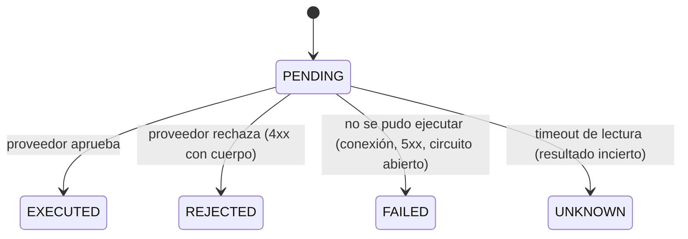

# Arquitectura objetivo

> Describe **a dónde** se llega, no cómo está escrito el código. Los detalles de implementación los decide el implementer dentro de estas fronteras.

## Contenedores

## Paquetes y dependencias

- `provider/http` depende de `transaction`; **nunca al revés** (ArchUnit).
- `common/web` traduce las excepciones de `transaction` a HTTP; con una sola funcionalidad se acepta esa dependencia mutua.

## Flujo de `POST /transactions`

## Estados

`PENDING` que no avanza y `UNKNOWN` requieren conciliación con el proveedor (fuera de alcance; se documenta en el README).

## Decisiones

Cada decisión con alternativas vive en `docs/adr/` (feature 7).
